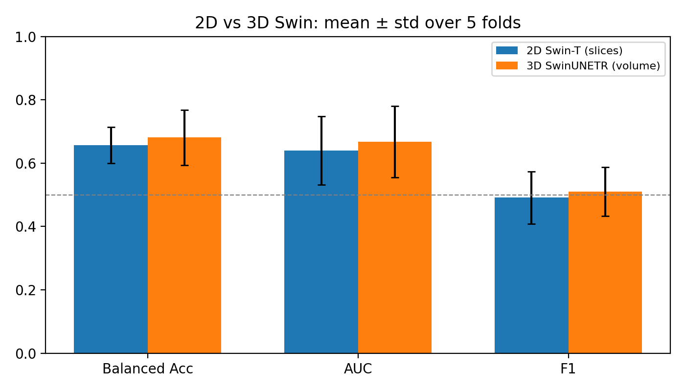
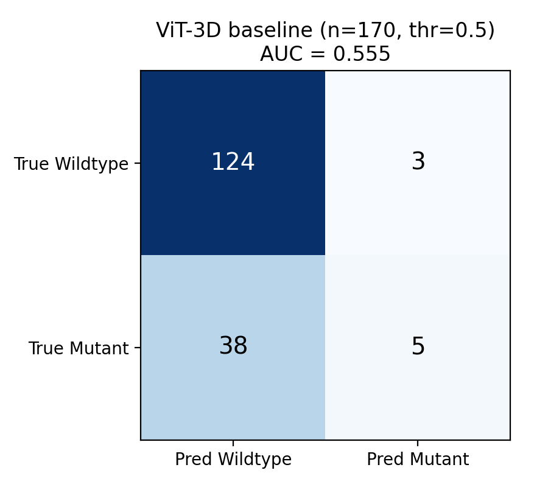

# EGFR mutation prediction in NSCLC from CT with Transformers

Bachelor thesis project (Electrical Engineering – Bioelectric, K. N. Toosi University of Technology).
The goal is to predict **EGFR mutation status (Mutant vs Wildtype)** of non-small cell lung cancer patients directly from chest CT, comparing a 2D slice-based Swin Transformer with a 3D Swin (SwinUNETR) encoder.

> Small, imbalanced dataset → modest performance. The repository documents the full pipeline *and* its limitations honestly; see [Results](#results) and [Limitations](#limitations).

## Data

* **NSCLC-Radiogenomics** (TCIA): CT + clinical/genomic labels, 211 patients in the image collection.
* 172 patients had a usable label and a preprocessed volume (**129 Wildtype / 43 Mutant**); 2 further volumes (R01-091, R01-133) were corrupted and excluded → **170 patients** in all model runs.
* The data are **not** redistributed here. Download them from TCIA and point the path constants in the notebooks to your copy.

## Pipeline

| Notebook | What it does |
|---|---|
| `01_preprocessing_and_series_selection.ipynb` | DICOM → HU, 1 mm isotropic resampling, body ROI crop, HU windowing to [0, 1], resizing; rule-based selection of the diagnostic chest-CT series (PET / scout / coronal / fusion series are penalised) |
| `02_qc_metadata_and_cv_splits.ipynb` | Health check of the preprocessed volumes, label join, patient-level **stratified 5-fold** split (`random_state=42`) |
| `03_2d_swin_slice_model.ipynb` | Scan-protocol confound check + 2D Swin-T (ImageNet-pretrained, timm) on 6 informative slices per patient |
| `04_3d_swinunetr_model.ipynb` | 3D SwinUNETR encoder (self-supervised CT pre-training), whole-volume classifier, focal loss |
| `05_vit3d_baseline_threshold_analysis.ipynb` | Threshold/calibration analysis of the first 3D ViT baseline (near-chance, kept as a negative result) |
| `results/make_figures.py` | Rebuilds every figure below from `results/cv_metrics.csv` and the saved predictions |

## Results

Patient-level metrics, mean ± std over the 5 cross-validation folds (per-fold values: [`results/cv_metrics.csv`](results/cv_metrics.csv)).

| Model | Accuracy | Balanced Acc | AUC | F1 |
|---|---|---|---|---|
| 2D Swin-T (6 slices / patient) | 0.719 ± 0.060 | 0.657 ± 0.057 | 0.640 ± 0.109 | 0.491 ± 0.083 |
| 3D SwinUNETR (64×96×96 volume) | 0.630 ± 0.068 | 0.681 ± 0.087 | 0.667 ± 0.113 | 0.510 ± 0.077 |

The difference between the two models is well inside the fold-to-fold variation, so I do **not** claim that one is better.



Early 3D ViT baseline (out-of-fold, 170 patients, threshold 0.5): AUC 0.555. Accuracy looks fine (0.76) only because 75 % of patients are Wildtype — the model finds just 5 of 43 mutants:



## Scan-protocol check

Voxel spacing in z differs between the two classes and between the two collections (AMC vs R01), so acquisition protocol could leak label information. `03_…` reports the numbers (z-spacing mean 1.39 mm for Wildtype vs 1.65 mm for Mutant; 1.24 mm AMC vs 1.54 mm R01). This is a descriptive check, not a proof of leakage either way.

## Limitations

* **No independent test set.** Cross-validation only, and for the 2D and 3D models the best epoch of each fold is selected on that fold's validation data (and the 3D threshold with Youden's J on it), so the reported numbers are optimistic.
* 170 patients, 43 positives: large fold-to-fold variance (AUC per fold ranges 0.51–0.83).
* Single dataset, no external validation; possible protocol/site confounding (above).
* The 2D model uses patient-level averaging over 6 automatically chosen slices, not tumour-segmentation-based slices.

## Running

```bash
pip install -r requirements.txt
# 1) download NSCLC-Radiogenomics from TCIA, 2) edit the path constants (D:\NSCLC_PROJECT\...) in each notebook,
# 3) run notebooks 01 → 04 in order, then:
python results/make_figures.py
```

Notebook comments are partly in Persian (my working language); code and results are language-independent.

## References

* Bakr S. et al., *A radiogenomic dataset of non-small cell lung cancer*, Scientific Data 5, 180202 (2018) — NSCLC-Radiogenomics.
* Tang Y. et al., *Self-supervised pre-training of Swin Transformers for 3D medical image analysis*, CVPR 2022 — source of the pre-trained SwinViT weights (`model_swinvit.pt`, Project MONAI); not redistributed here.
* MONAI (`SwinUNETR`), timm (`swin_tiny_patch4_window7_224`), PyTorch, scikit-learn.
